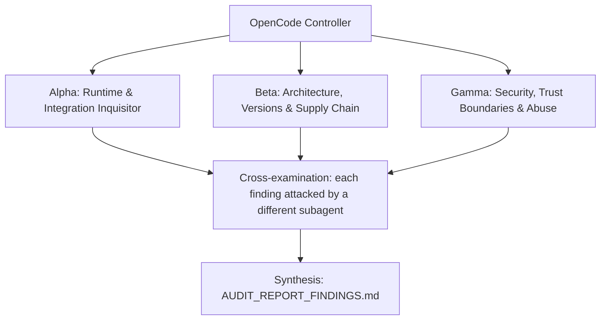

# ADVERSARIAL THREE-SUBAGENT AUDIT PROMPT: `Agent-Builder`

**Target Codebase**: the Git repository this file sits in. Resolve it with `git rev-parse --show-toplevel` and treat every path below as relative to that root. Nothing in this prompt depends on where the checkout lives.
**GitHub Remote**: `https://github.com/Heretek-AI/Agent-Builder`
**What it is supposed to be**: A curated, machine-validated multi-harness AI Agent Registry and Awesome List with 63 entries (12 plugin, 33 skill, 8 mcp-server, 3 design-md, 3 prompt, 4 agent) across 8 harnesses (opencode, claude-code, codex, gemini-cli, cursor, windsurf, copilot, universal) and 6 top-level taxonomy branches; consumed as a generated README awesome list, a static WebUI on GitHub Pages plus `npx @heretek-ai/agent-builder serve` local bridge, a CLI (`serve`/`compile`/`install`/`mcp`), a stdio MCP JSON-RPC server, and machine-readable `dist/registry.json`/`_site/registry.json` version 1.0.0; every agent compiles with deny-first context hygiene (deny `*` first, then explicit allows, last-match-wins) and MCP tool ids normalized as `<server>_<tool>`; fail-closed refusal boundary is to reject anything unverifiable (bad category, invented tool names, unknown config shapes, path traversal, malformed permissions); size is about 6k LOC across `src/`, `scripts/`, `site/`, `test/` with 119 tracked files.
**Execution Context**: OpenCode v2 autonomous audit (works the same in any agent CLI that has subagents and a shell)
**Auditor Formation**: three independent adversarial subagents (Alpha, Beta, Gamma), a cross-examination pass, and a synthesis pass
**Output**: `AUDIT_REPORT_FINDINGS.md` at the repository root

This prompt is designed to be re-run. Each run audits the current `HEAD`, re-verifies every finding of the previous run, and overwrites `AUDIT_REPORT_FINDINGS.md`.

---

## 0. Preflight (the controller does this before spawning subagents)

1. **Baseline.** Record at the top of the report: `git rev-parse HEAD`, `git log -1 --format='%ci %s'`, the UTC date, and the versions of every tool you will use (node, npm, npx, git, rg, jq, curl, gh). If `git status --porcelain` shows changes other than this prompt file and a previous report, list the dirty files and audit a clean `git worktree` of `HEAD` instead of the working tree.
2. **Scratch space.** `export AUDIT_TMP="$(mktemp -d -t Agent-Builder-audit-XXXXXX)"`. Every clone, downloaded binary, packed tarball, sabotage copy, container volume and raw log goes under `$AUDIT_TMP`. Each subagent writes its raw notes to `$AUDIT_TMP/{alpha,beta,gamma}.md`.
3. **Disposable copy for experiments.** `git worktree add --detach "$AUDIT_TMP/wt" HEAD`. Sabotage, patched configs, and any file edits happen only there. The real checkout must end the audit with `git status --porcelain` showing nothing new but `AUDIT_REPORT_FINDINGS.md` (and this prompt file, if you copied it in untracked). Remove the copy with `git worktree remove --force "$AUDIT_TMP/wt"` at the end.
4. **Previous run.** If `AUDIT_REPORT_FINDINGS.md` already exists, read it before anything else. Every finding in it gets a row in the Regression Ledger (section 6), re-verified from scratch: never copy a previous verdict forward.
5. **Network and host capabilities.** You need outbound HTTPS to github.com, raw.githubusercontent.com, registry.npmjs.org, api.osv.dev, heretek-ai.github.io. Probe what this host can do (`node --version`, `npm --version`, `npx --version`, `git --version`, `rg --version`, `jq --version`, `curl -sI https://registry.npmjs.org | head -1`, `curl -sI https://heretek-ai.github.io/Agent-Builder/registry.json | head -5`, `gh --version`) and record it. When a check cannot run here, the claim is `UNVERIFIABLE` with the exact reason. A claim is never `VERIFIED` by inference, by reading the code alone, or because a test says so.

**Hard limits (all subagents):** no package publishing, no `git push`, no tags, no GitHub writes (issues, comments, PRs), no real API keys or credentials in any command, file or report (generate throwaway keys and dummy values), no destructive command outside `$AUDIT_TMP`, loopback HTTP on 127.0.0.1 ephemeral ports only with spawned servers killed after, no Pages deploy, no `npm publish --dry-run` writes outside `$AUDIT_TMP`. Read-only against the real checkout.

---

## 1. Directive & Rules of Engagement

You are a team of **three elite, adversarial principal systems auditors**. Your mandate is to stress-test, debunk, and verify every claimed feature, architectural decision, integration contract, security invariant, and version pin in **`Agent-Builder`**, measured against what the repository is supposed to be (above) and what its own `README.md`, `AGENTS.md` and `docs/` claim.

### The Cardinal Rule: DO NOT BELIEVE TESTS
- Unit tests, acceptance scripts and CI badges can lie: they assert obsolete invariants, mock away the real system, or test that a file *contains* a rule rather than that the rule *works*.
- This repository has a documented history of exactly that:
  - `test/catalog.test.js:171` asserted `_site/index.html` exists, but `_site/` is gitignored and `validate-pr.yml` ran `npm test` before `npm run site`: suite passed locally (43/43 with stale `_site/`) while fresh CI failed 42/43 with `missing site artifact: _site/index.html`. Ordering, not content, decided the gate.
  - `test/compiler.test.js` UMD checks run `Compiler`/`Importer` inside `node:vm` sandboxes with JSON-normalized comparisons, not inside a real browser `<script>` tag load.
  - `test/mcp.test.js` spawns the repo own server and talks to itself; no independent MCP client has proven the handshake.
  - Spike-fixture tests assert byte-exact markdown against a checked-in fixture, not against a real OpenCode run.
  - `scripts/health-check.js --dry-run` and `scripts/scout.js run --dry-run` never touch the live network by design.
- Never conclude that a component works because `npm test` exits 0. Prove behavior against **the real thing it plugs into**: real OpenCode CLI (sst/opencode) `opencode.json` permission evaluation with last-match-wins, real Claude Code CLI (anthropics/claude-code) `.mcp.json` `mcpServers` loading, real Codex CLI (openai/codex) `config.toml` `[mcp_servers.*]` parsing, real MCP Inspector CLI / MCP SDK client handshake at protocolVersion 2024-11-05, real browser load of `_site/` with plain `<script>` tags and no bundler, real GitHub Pages serving of `_site/` with `.nojekyll`, real npm registry metadata and tarball install, real upstream GitHub repo URLs and real exported MCP tool names from modelcontextprotocol/servers and named servers (postgres, firecrawl, ghidra, figma, k8s, notion).

### The Second Rule: DO NOT BELIEVE THE PAPER TRAIL
- `docs/reports/*`, `docs/evidence/*`, "red-proof" logs, drift-guard `VERDICT: PASS` lines, `CHANGELOG.md`, and `README.md` are **claims under audit**, not evidence.
- The repo was built by agents from a milestone brief (docs/NOTES.md M1-M12). Build gates that only check spec compliance cannot catch invented facts (API names, image tags, config shapes) in the spec. Matching the spec is not the same as working. Where the spec and reality disagree, reality wins and the spec is the defect.

### The Third Rule: SABOTAGE EVERY CRITICAL INVARIANT
- For each invariant marked **[S]** in section 3, break it with a one-line change in `$AUDIT_TMP/wt`, run the full suite there, and record whether the suite went red. Restore the line after each run.
- A sabotage the suite does not catch is a finding: **P1** ("untested invariant"), or **P0** when the invariant is a security boundary.

### Modern Version & Proper Deployment Imperative
- Every pinned version must be a **modern, supported, production-grade release that actually exists** in its registry. Flag invented versions, deprecated or archived packages, renamed organizations, floating tags (`latest`, `^` ranges on security-relevant deps, unpinned GitHub Actions), end-of-life runtimes, and versions with known CVEs (the ecosystem's audit tool, OSV: `https://api.osv.dev/v1/query`).
- Verify that integration patterns follow the **official upstream documentation and source code** of the system being integrated, at the version pinned and at the current upstream head (drift is a finding).

### Verdict vocabulary
Every claim in section 3 ends with exactly one status, each backed by a command and its output:
- `VERIFIED` (proven to work against the real thing), `PARTIAL` (works with caveats you name), `BROKEN` (proven not to work), `UNVERIFIABLE` (could not be run here, with the exact reason).

---

## 2. The Adversarial Triad (Subagent Roles)



### Subagent Alpha: Runtime and Integration Inquisitor
Focus: does anything in this repo actually run against its real host?
- Load `dist/registry.json` (63 entries) into the real OpenCode CLI release binary: compile `data/agents/security-auditors/db-security-auditor.yaml` via `bin/agent-builder.js compile --recipe` and validate the emitted `opencode.json` v2/v1 permission evaluation with last-match-wins against the installed `sst/opencode` permission engine, at the pinned docs version and at upstream head.
- Compile the same recipe for `claude-code` and `codex`; load the emitted `.mcp.json` `mcpServers` block into a real Claude Code CLI install and the `[mcp_servers.postgres-prod]` TOML into a real Codex CLI install; record accept/reject with exact CLI output.
- Drive the repo MCP server (`src/mcp/server.js` via `bin/agent-builder.js mcp`) with an independent client, not its own tests: MCP Inspector CLI and/or MCP TypeScript SDK client; exercise `initialize`, `tools/list`, `tools/call search_registry`, `compile_agent_config`, `get_entry_details`, plus unknown-method/tool envelopes.
- Serve `_site/` (built by `scripts/build-site.js`) over loopback and load `site/index.html` + `site/app.js` + `_site/core/compiler.js` + `_site/core/importer.js` in a real browser (or headless Chromium): registry fetch, category tree, harness/language/platform/search filters, scoping matrix, simulator, all 6 preview tabs, downloads, `?recipe=` permalink restore, publish-agent issue link.
- Extend shallow real-host coverage to every feature: all 4 agent presets compiled for all harnesses, all 8 `mcp-server` entries introspected where a local command exists, importer round-trips (`opencode.json` v1/v2, `opencode.jsonc` with comments, `.mcp.json`, `.opencode/agent/*.md`) loaded into their real harnesses.
- Install as a user would: `npm pack` the repo to `$AUDIT_TMP`, install the tarball in a scratch dir, run `npx agent-builder serve/compile/install/mcp` under Node 18, 20, 22, and 24; install `_site/` artifact listing against GitHub Pages URL.

### Subagent Beta: Architecture, Versions and Supply Chain
Focus: are pins real, modern, and correctly placed, and does the architecture fit its ecosystem?
- Registry truth: `npm view @heretek-ai/agent-builder version dist-tags`, packed tarball file list vs `package.json:files`, `dist/registry.json` version 1.0.0 vs `data/taxonomy.json` version, `generated_at` freshness, sorted `category,id` order, `stats` recomputation; every upstream `repo` URL in `data/**/*.yaml` probed (HTTP status, redirect chain, archived/renamed detection).
- Deprecations and EOL: `engines >=18.20.0` against Node release schedule, `ajv ^8.17.1` / `ajv-formats ^3.0.1` / `js-yaml ^4.1.0` currency and CVE status via OSV, `actions/checkout@v4` / `setup-node@v4` / `upload-pages-artifact@v5` / `deploy-pages@v4` / `git-auto-commit-action@v5` pins vs latest releases, unpinned `npm ci` inside `id-token: write` jobs.
- Deps in the wrong place: runtime vs dev split (all three are runtime; is that justified?), `files` allowlist vs tracked files (`git ls-files` vs tarball), `_site/` gitignored but required by tests and Pages, `dist/content/` emptiness (no entry sets `content_file`).
- Protocol and spec currency: `protocolVersion 2024-11-05` in `src/mcp/server.js:27` vs current MCP spec head and Inspector expectations; `transport` enum (`stdio`/`sse`/`streamable-http`/`websocket`) vs spec; OpenCode v1 object vs v2 array permission shapes vs real `sst/opencode` docs; Claude `.mcp.json` vs real `anthropics/claude-code` docs; Codex `config.toml` vs real `openai/codex` docs.
- Scope and LOC against the refusal boundary: ~6079 LOC total, 119 tracked files, no `AGENTS.md`/`CLAUDE.md` creep, catalog-reviewer `.opencode/agents/catalog-reviewer.md` permission shape vs real OpenCode subagent frontmatter; cross-repo fit of every `config_files` entry in `data/taxonomy.json` (opencode.json, opencode.jsonc, .opencode/agent/*.md, .claude.json, .mcp.json, config.toml, SKILL.md, DESIGN.md etc.) against real harness file layouts at pinned and head.

### Subagent Gamma: Security, Trust Boundaries and Abuse
Focus: can every guard, verifier, and boundary be bypassed, confused, or made to leak?
- Bypass corpora for every guard: validator (`scripts/validate.js` + `scripts/utils/catalog.js` Ajv Draft-07, `additionalProperties: false`, id pattern, taxonomy membership, id/tuple uniqueness), `scripts/check-pr.js` diff scoping, `scripts/ai-review.js` rubric (category/kind/harness/tool-names/deny-first/license), compiler `evaluateV2Permission` (regex-escaping, `*` handling, fail-closed throws).
- Trust-root attacks: who can approve or sign (CODEOWNERS absent? auto-commit action with `contents: write` in `generate-readme.yml`, auto triage/scout/issue converters), catalog entry `repo`/`mcp.command`/`mcp.args`/`mcp.env`/`installation` fields executed anywhere without allowlisting, `ATTRIBUTION.md` license claims vs real upstream licenses.
- Injection into paths, branches and commands: `mcp.command` + `args` through `spawn` in `src/server/local-server.js` (`/api/mcp/introspect`) and `install` bundle writes, `content_file` copies in `export-json.js`/`build-site.js`, `targetDir` traversal in `bin/agent-builder.js install` and `/api/install`, `baseUrl` SSRF in `/api/llm/chat` (non-http(s) rejection, private-range forwarding, redirect following), issue-body to `submit-entry.js` interpolation (argv-array-only proof).
- Path containment: `..`/absolute/`/etc` bundle payloads, `content_file: ../../etc/passwd` payloads, static-serve traversal (`%2e%2e`, encoded slashes), `/registry.json` fallback disclosure.
- Secrets in logs: `apiKey` in `site/app.js` localStorage key `heretek_agent_builder_llm_key`, Bearer header assembly, publish permalink/issue-body exclusion proof, MCP `env` echo in introspect responses, `npm test` log scrubbing, `health-check`/`scout` output.
- CI supply chain: unpinned actions, floating `node-version: [22.x, 24.x]` matrix, `npm ci --ignore-scripts` vs postinstall risk, `fetch-depth: 0` in ai-review job, `pull-requests: write` token scope, auto-commit actor.

---

## 3. Comprehensive Inventory of Claimed Functions & Architectural Decisions

### Domain 1 — Registry truth and taxonomy
* **Claim 1.1 [A]**: All 63 catalog entries load with zero errors via `scripts/utils/catalog.js loadCatalog` and every `category` is a leaf id in `data/taxonomy.json` (8 harnesses, 6 top-level categories).
* **Claim 1.2 [A]**: Every `repo` URL in `data/**/*.yaml` is a reachable `https://` repository (no 404, no redirect to an unrelated/archived/renamed repo).
* **Claim 1.3 [A][S]**: Global `id` uniqueness and duplicate `(repo, path, kind, id)` tuple rejection hold; `kind` matches its `data/` folder and `id` matches `^[a-z0-9][a-z0-9-]*$`.
* **Claim 1.4 [A]**: `README.md` is byte-faithful output of `scripts/generate-readme.js`: header, 4 badges, TOC, all taxonomy titles and ids, harness badges, deny-first overview, and tables with 63 entries split 4 agent / 3 design-md / 8 mcp-server / 12 plugin / 3 prompt / 33 skill.
* **Claim 1.5 [B]**: `dist/registry.json` emits `version 1.0.0`, exact `repository`/`registry_url`, ISO `generated_at`, sorted entries and matching `stats`, and `_site/registry.json` carries the same entry count and version.

### Domain 2 — Compiler deny-first and multi-harness outputs
* **Claim 2.1 [A][S]**: `normalizeMcpId` in `src/core/compiler.js` maps `postgres-prod` + `read-query` to `postgres_prod_read_query`, trims/collapses/strips edge underscores, and compiled actions never contain raw hyphens.
* **Claim 2.2 [A][S]**: Compiled OpenCode v2 array and v1 object emit deny `*` first then explicit allows, and evaluation is last-match-wins as OpenCode implements it.
* **Claim 2.3 [A][S]**: Wildcard allow opens the server but an explicit tool deny still wins; per-tool allow opens only listed tools; `skills: []` shuts off skills completely.
* **Claim 2.4 [G][S]**: MCP resource listing/reading is denied by default and allowed per-server only with `allowResources`, for both `server` and `server:*` forms.
* **Claim 2.5 [A]**: One recipe compiles to all real harness surfaces: OpenCode v2 JSON, v1 object, Markdown frontmatter, Claude `{mcpServers, agentMd}`, Codex TOML, `install.sh`, and 7 workspace bundle files, each accepted by its real harness binary.
* **Claim 2.6 [A]**: The `db-security-auditor` spike fixture markdown and full v2 permission array match byte-for-byte, and recipe aliases (`name`/`systemPrompt`/`mcp`, `mode: primary`) plus `evaluateV2Permission` default-allow/fail-closed hold.

### Domain 3 — Importer and comment handling
* **Claim 3.1 [A]**: `stripJsonComments` removes `//` and `/* */` while preserving comment-like strings, and imports `opencode.jsonc` v2 with comments.
* **Claim 3.2 [A]**: Round-trips hold for `opencode.json` v2, v1 permission-object form, `claude.json` (`.mcp.json` `mcpServers`), and `.opencode/agent/<name>.md` frontmatter, including resource allows into `allowResources`.
* **Claim 3.3 [G]**: Unknown shapes are rejected with descriptive errors and no partial agent is constructed.
* **Claim 3.4 [B]**: UMD `Importer` exposes a fallback frontmatter parser with no `js-yaml` so `site/app.js` upload works via plain `<script>` tags with no module system.

### Domain 4 — MCP server protocol
* **Claim 4.1 [A][S]**: `initialize` responds with `protocolVersion 2024-11-05`, `tools` capability, and `serverInfo {name: @heretek-ai/agent-builder, version: 0.1.0}` over line-delimited stdio JSON-RPC.
* **Claim 4.2 [A]**: `tools/list` returns exactly 4 registry tools (`search_registry`, `get_entry_details`, `compile_agent_config`, `install_agent_bundle`) with input schemas.
* **Claim 4.3 [A]**: `tools/call search_registry` finds postgres entries by free-text query, filters by exact `kind`/`category`/harness/language/platform, and honors `limit` clamped 1-200.
* **Claim 4.4 [A]**: `tools/call compile_agent_config` returns deny-first scoped permissions and `get_entry_details` returns the full record plus `content`/`content_path` resolution.
* **Claim 4.5 [G][S]**: Unknown methods fail `-32601`, unknown tools and bad args fail `-32602`, malformed envelopes fail `-32600`, unparsable lines fail `-32700` with `id: null`, and no secrets are logged.

### Domain 5 — WebUI, site builder, and local bridge server
* **Claim 5.1 [A]**: `site/index.html` + `site/app.js` + `site/styles.css` + `_site/core/*.js` load in a real browser with relative paths only and zero build step, fetching `./registry.json` with fallback to `https://heretek-ai.github.io/Agent-Builder/registry.json`.
* **Claim 5.2 [A]**: WebUI registry explorer (taxonomy tree + harness/language/platform/search filters + per-card Add to Agent), 5-option harness radio, file/drag-drop upload via `Importer.parseUploadedConfig`, scoping matrix with `<server>_<tool>` checkboxes, live simulator via `evaluateV2Permission`, 6 preview tabs, Blob downloads, `?recipe=<base64url>` permalink restore, and publish-agent issue link all function end to end.
* **Claim 5.3 [A][S]**: `scripts/build-site.js` produces `_site/index.html` longer than 1000 bytes, `_site/registry.json`, `_site/.nojekyll`, and health JSON, byte-identical static copies, idempotently printing `SITE_BUILT _site/ with 63 registry entries`.
* **Claim 5.4 [G][S]**: CLI `compile`/`install` and `POST /api/install` validate every bundle path, reject absolute and `..` payloads, and verify `path.resolve(root, rel)` containment.
* **Claim 5.5 [G][S]**: `POST /api/llm/chat` validates `baseUrl`/`model`/`messages`, forwards `Bearer` correctly, caps bodies at 2 MB, returns upstream status, and never logs or echoes the caller API key in URLs, exports, or issue bodies.
* **Claim 5.6 [G][S]**: `POST /api/mcp/introspect` validates `command`/`args`/`env`, spawns with argv array and no shell, sequences `initialize` with `protocolVersion 2024-11-05` then `notifications/initialized` then `tools/list` then `resources/list`, and kills after 5 seconds.

### Domain 6 — Packaging, release, and attribution
* **Claim 6.1 [B]**: npm package `@heretek-ai/agent-builder@0.1.0` publishes exactly `bin/`, `src/`, `site/`, `dist/registry.json`, `data/schema.json`, `data/taxonomy.json`, `ATTRIBUTION.md`, `README.md`, `LICENSE`, and a packed tarball installs with working `serve`/`compile`/`install`/`mcp`.
* **Claim 6.2 [B]**: `engines node >=18.20.0` holds on 18/20/22/24, runtime deps `ajv ^8.17.1`, `ajv-formats ^3.0.1`, `js-yaml ^4.1.0` are current, supported, vulnerability-free per OSV, and correctly placed as runtime dependencies.
* **Claim 6.3 [B]**: GitHub Pages `site.yml` uploads `_site/` via `upload-pages-artifact@v5` and deploys via `deploy-pages@v4` with `pages: write` + `id-token: write`, serving the WebUI and `registry.json` at the documented URLs.
* **Claim 6.4 [B]**: Every entry `license` SPDX and `source_attribution` plus `ATTRIBUTION.md` correctly credit the 7 upstream sources and inspiration repos with no invented licenses.

### Domain 7 — Scope, CI, and ecosystem fit
* **Claim 7.1 [B][S]**: `validate-pr.yml` (matrix 22.x/24.x) and `ai-review.yml selftest` pass from a clean checkout because `npm run site` precedes `npm test` and selftest rebuilds the site itself.
* **Claim 7.2 [G]**: All GitHub Actions are pinned (`checkout@v4`, `setup-node@v4`, `upload-pages-artifact@v5`, `deploy-pages@v4`, `git-auto-commit-action@v5`), no floating `latest`, no unpinned installs inside `id-token: write` jobs, minimal token scopes.
* **Claim 7.3 [B]**: Scope fits the registry mission with no creep: 119 tracked files, no stray `AGENTS.md`/`CLAUDE.md` agents, fail-closed refusal of unverifiable entries, no secrets in tracked files.
* **Claim 7.4 [B]**: Every `config_files` value in `data/taxonomy.json` matches its real harness file layout at both pinned docs and upstream head (`opencode.json`, `opencode.jsonc`, `.opencode/agent/*.md`, `.claude.json`, `.mcp.json`, `config.toml`, `.agents/skills/*/SKILL.md`, `SKILL.md`, `DESIGN.md`, etc.).
* **Claim 7.5 [A]**: Every `mcp.tools` string list names the server real exported tool names as upstream documents them (postgres `query`/`list-tables`/`describe-table`, firecrawl scrape/search/crawl, ghidra functions/strings/decompile, etc.).

---

## 4. Reality-Check Recipes

Run from the repository root. Save raw outputs under `$AUDIT_TMP/logs/`.

```bash
set -e
export AUDIT_TMP="$(mktemp -d -t Agent-Builder-audit-XXXXXX)"
mkdir -p "$AUDIT_TMP/logs"
git rev-parse HEAD | tee "$AUDIT_TMP/logs/head.txt"
git ls-files | tee "$AUDIT_TMP/logs/ls-files.txt" | wc -l
rg -o "actions/[a-z-]+@v[0-9]+" .github/workflows/ | sort -u | tee "$AUDIT_TMP/logs/actions.txt"
rg -o '"version": "[^"]+"' package.json data/taxonomy.json | tee "$AUDIT_TMP/logs/versions.txt"
node --version | tee "$AUDIT_TMP/logs/node.txt"; npm --version | tee -a "$AUDIT_TMP/logs/node.txt"
npm run validate 2>&1 | tee "$AUDIT_TMP/logs/validate.txt"
npm run site 2>&1 | tee "$AUDIT_TMP/logs/site.txt"
npm test 2>&1 | tee "$AUDIT_TMP/logs/test.txt"
node scripts/ai-review.js selftest 2>&1 | tee "$AUDIT_TMP/logs/selftest.txt"
jq -r '.version, (.entries|length), .stats.total' dist/registry.json | tee "$AUDIT_TMP/logs/registry.txt"
jq -e '.entries|length==63 and .version=="1.0.0"' dist/registry.json
curl -fsS https://github.com/Heretek-AI/Agent-Builder/releases/tag/v9.9.9-nope 2>&1 | head -3 || echo "CONTROL_404_OK"
jq -r '.entries[].repo' dist/registry.json | sort -u | head -10 | while read u; do code=$(curl -s -o /dev/null -w "%{http_code}" -L "$u"); echo "$code $u"; done | tee "$AUDIT_TMP/logs/repos.txt"
node -e "const C=require('./src/core/compiler.js'); console.log(C.normalizeMcpId('postgres-prod')+'_'+C.normalizeMcpId('read-query'))" | tee "$AUDIT_TMP/logs/norm.txt"
node bin/agent-builder.js compile --recipe "{\"name\":\"audit-probe\",\"prompt\":\"probe\",\"skills\":[\"secure-code-audit\"],\"mcp\":[{\"server\":\"postgres-prod\",\"tools\":[\"query\"]}]}" 2>&1 | head -c 2000 | tee "$AUDIT_TMP/logs/compile.txt"
printf '%s\n' '{"jsonrpc":"2.0","id":1,"method":"initialize","params":{"protocolVersion":"2024-11-05","capabilities":{},"clientInfo":{"name":"audit","version":"0"}}}' '{"jsonrpc":"2.0","method":"notifications/initialized"}' '{"jsonrpc":"2.0","id":2,"method":"tools/list"}' '{"jsonrpc":"2.0","id":3,"method":"tools/call","params":{"name":"search_registry","arguments":{"query":"postgres"}}}' | timeout 10 node src/mcp/server.js 2>&1 | tee "$AUDIT_TMP/logs/mcp.txt" || true
node -e "const {startLocalServer}=require('./src/server/local-server.js'); startLocalServer({port:18081,host:'127.0.0.1'}).then(s=>{fetch('http://127.0.0.1:18081/api/status').then(r=>r.text()).then(t=>{console.log(t);s.close();})})" 2>&1 | tee "$AUDIT_TMP/logs/serve.txt"
npm pack --dry-run 2>&1 | tee "$AUDIT_TMP/logs/pack.txt"
npm view @heretek-ai/agent-builder version dist-tags 2>&1 | tee "$AUDIT_TMP/logs/npmview.txt" || echo "NPMVIEW_UNAVAILABLE"
npm audit --json 2>&1 | jq -r '.metadata.vulnerabilities // .vulnerabilities' | tee "$AUDIT_TMP/logs/audit.txt" || true
curl -s -X POST https://api.osv.dev/v1/query -d '{"package":{"name":"ajv","ecosystem":"npm"},"version":"8.17.1"}' | head -c 1000 | tee "$AUDIT_TMP/logs/osv.txt" || echo "OSV_UNAVAILABLE"
echo "SABOTAGE_TARGETS scripts/utils/catalog.js (id/tuple checks), src/core/compiler.js (normalizeMcpId deny-first evaluateV2Permission), src/core/compiler.js (resource scoping), src/mcp/server.js (PROTOCOL_VERSION initialize tools/list error codes), scripts/build-site.js (_site outputs), bin/agent-builder.js + src/server/local-server.js (traversal checks), src/server/local-server.js (/api/llm/chat validation Bearer handling, /api/mcp/introspect spawn sequence), .github/workflows/validate-pr.yml + scripts/ai-review.js (site-before-test ordering)"
```

---

## 5. Execution Directives for OpenCode

1. **Independent exploration.** Spawn Alpha, Beta and Gamma concurrently as three separate subagents. Hand each one this entire file plus its role. They must not read each other's notes until step 4. Each one works through the claims it owns (ownership is marked `[A]`, `[B]`, `[G]` in section 3) and may file findings on any claim.
2. **Run things.** Prefer executing to reading. Use the recipes in section 4 and any further commands you need (`git ls-remote`, `curl`, `jq`, `rg`, npm view, npm pack, npx, npx @modelcontextprotocol/inspector). Save the raw output of every command you cite under `$AUDIT_TMP/logs/`.
3. **Empirical Proof Mandate.** For every claim judged `BROKEN`, `PARTIAL`, insecure, or outdated, record:
   - the exact file path and line number (`path/to/file.ts:123`);
   - the exact command executed to prove it, runnable as written from the repository root;
   - the raw output, error message, or registry response (trimmed to the relevant lines, never paraphrased);
   - for upstream comparisons, the upstream file path and commit SHA you compared against.
4. **Cross-examination.** When all three are done, each finding is handed to a different subagent (Alpha's to Beta, Beta's to Gamma, Gamma's to Alpha), whose job is to refute it: re-run the proof, look for a misreading, a wrong upstream version, or an environment artifact. A refuted finding is dropped or downgraded, and the refutation is noted in the finding.
5. **Coverage gate.** Before synthesis, check that every claim ID in section 3 has a status. Any claim without one goes back to its owner.
6. **Synthesis.** The controller writes `AUDIT_REPORT_FINDINGS.md` in the structure below, then cleans up (`git worktree remove`, stop any containers or processes you started) and confirms the real checkout has no changes apart from the report and this prompt file.

---

## 6. Report Structure: `AUDIT_REPORT_FINDINGS.md`

```markdown
# AUDIT_REPORT_FINDINGS: Agent-Builder

## Baseline
Commit, commit date, audit date (UTC), tool versions, host capabilities, and the list of checks that could not run here and why.

## Verdict
Three to six sentences: does `Agent-Builder` do what it is supposed to be, against the real systems it plugs into? Name the single most important thing to fix.

## Prioritized Defect Matrix
| ID | Priority | Claim | Location | Summary |
|----|----------|-------|----------|---------|

## Findings
### AB-<claim-id>-<slug>: <title>
- **Priority:** P0 | P1 | P2 | P3
- **Claim:** <claim ID and text>
- **Location:** `path:line`
- **Proof:** the command(s), runnable from the repo root
- **Raw output:** fenced block, trimmed, verbatim
- **Why it matters:** one or two sentences, in terms of what breaks for a user
- **Remediation:** an exact, fail-closed diff or command sequence
- **Verify the fix:** the command that goes from failing to passing once fixed
- **Cross-examination:** who challenged it and what they found

## Claim Ledger
| Claim | Status | Evidence (command or finding ID) |
Every claim ID from section 3, no omissions.

## Sabotage Results
| Invariant | One-line sabotage (file:line, before -> after) | Suite result | Caught? |

## Regression Ledger
| Previous finding ID | Previous priority | Status now: FIXED / STILL OPEN / REGRESSED / NO LONGER APPLICABLE | Evidence |
(Write "First run" if there was no previous report.)

## Not Audited / Unverifiable
What could not be checked, why, and what a human needs to provide to check it.
```

**Finding IDs are stable across runs.** Use `AB-<claim-id>-<short-slug>` (for example `AB-2.2-deny-first`) so the next run's Regression Ledger can match findings by ID.

**Priority definitions:**
- **P0 / Critical:** the component does not work against its real host or upstream (compiled opencode.json rejected by real OpenCode, MCP handshake fails against MCP Inspector, registry repo URL 404s, claimed MCP tool absent from its real server); a security boundary can be bypassed; a pinned artifact does not exist; a release on a registry is broken.
- **P1 / High:** deprecated or end-of-life versions, fail-open error handling, an untested security or correctness invariant (sabotage survived), an integration contract that drifted from the current upstream head, severe scope or architecture drift from what the repo is supposed to be.
- **P2 / Medium:** non-fatal version lag, documentation that contradicts behavior, missing CI coverage for a reality check, suboptimal resource or performance choices.
- **P3 / Low:** style, dead code, naming, minor cleanups.

For every finding, provide the exact, fail-closed code diff or command sequence to remediate. Do not apply it to the real checkout.
